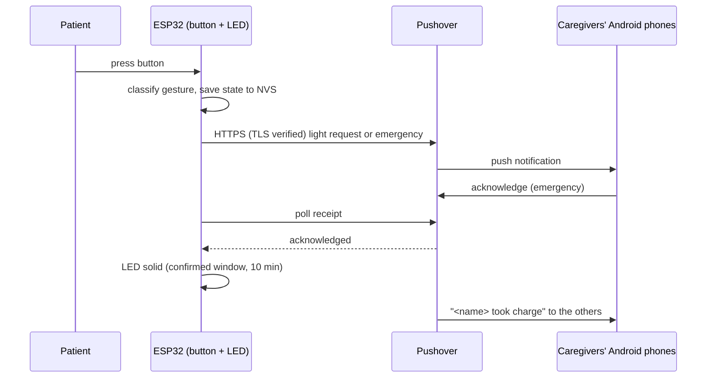

# ESP32 Patient Alert

**One-button emergency call button for bedridden patients and caregivers, with Pushover push notifications.**

[](https://github.com/frapsd/esp32-patient-alert/actions/workflows/ci.yml)
[](LICENSE)
[](https://platformio.org)
[](https://www.espressif.com/en/products/socs/esp32)

**English** | [Italiano](README.it.md)

> **WARNING: this is NOT a certified medical device and does NOT replace emergency services.**
> **If the situation is serious, call emergency services immediately.**
> **Without home internet (or without power) the alarm does NOT fire.** The device alerts
> nobody if it is off or disconnected from the network.

> **v1 status:** the logic is verified by automated tests and the firmware boots on the board,
> but the real network path (Wi-Fi -> Pushover -> phone) has **not yet been tested end to end**.
> Before relying on it, run tests 1-4, 8 and 10 in [docs/manual-tests.md](docs/manual-tests.md)
> (in Italian) with your real secrets.

## Features

- **Light help request**: a normal Pushover notification (water, change of position...), no loud ringing.
- **Emergency**: Pushover priority 2. It sounds even with the phone on silent and repeats every 30 seconds until a caregiver taps "acknowledge" on the phone.
- **Acknowledgement feedback**: when someone acknowledges, the LED turns solid ("help is coming") and the other caregivers get a "<name> took charge of the emergency" message.
- **Re-escalation**: if nobody acknowledges within 1500 s (25 minutes), a new emergency is sent immediately, without gaps.
- **Survives reboots**: an emergency is saved to NVS before it is sent and resumed after a restart; the "confirmed" window is restored too.
- **Offline-tolerant**: a press made without network is remembered and sent when the connection returns (the queue keeps at most 4 light requests, each with its press time).
- **Secure transport**: TLS to `api.pushover.net` with certificate verification against embedded root CAs; never disabled.
- **Watchdog**: a 60 s watchdog restarts the board if the main loop or the button/LED task hangs.
- **Tested logic**: pure C++ in `lib/alert_core`, 64 native Unity tests (`pio test -e native`), plus a manual hardware checklist.

Principle: when in doubt, emergency.

## How it works



Until the emergency is acknowledged, Pushover repeats it every 30 s and the LED blinks fast.

## Button gestures

| Gesture | Effect |
|---|---|
| Short press (under 1.5 s) | Light request, sent immediately |
| Hold 1.5 s or more | Emergency (fires when 1.5 s elapse, without waiting for release) |
| Another press within 60 s of a light request | Emergency |
| Any press while an emergency is active and unacknowledged | No new alarm (LED keeps blinking fast) |
| Any press while the LED is solid "confirmed" | New emergency to everyone |
| Press after the "confirmed" window ends (10 minutes) | Back to normal: short = light, long = emergency |

## LED patterns

| LED | Meaning |
|---|---|
| Very short flash (0.05 s) every 5 s | All good: Wi-Fi and time OK, no alarm |
| On 1 s, off 1 s | Offline: no Wi-Fi, or time not yet synchronized |
| Solid for 3 s | Light request sent |
| Continuous fast blink (0.1 s on, 0.1 s off) | Emergency being sent or awaiting acknowledgement |
| Solid | Emergency acknowledged, "help is coming" (lasts 10 minutes) |
| Two short flashes every 2 s | Configuration error: Pushover rejects requests (wrong token or key, monthly quota exhausted, etc.) |

When several conditions hold at once, the first in this list wins: active emergency, confirmed emergency (within the 10-minute window), configuration error, offline, "light request sent" (3 s), idle. "Request sent" (3 s) and "confirmed" (10 min) are both solid and are told apart by duration.

## Hardware

| Part | Notes |
|---|---|
| ESP32 dev board | Built for `esp32dev` (4 MB flash) |
| Momentary push button | Wired between the GPIO pin and GND; the firmware enables the internal pull-up |
| LED + series resistor | 220-330 ohm to GND, e.g. on GPIO26 or GPIO27, with `LED_ACTIVE_HIGH true` |
| USB power supply | No backup battery in v1 |

Out of the box the button is the board's BOOT key (GPIO0) and the LED is the on-board one (GPIO2, check on your board) so you can try it without wiring. For the final hardware edit **only** `include/config.h` (`PIN_BUTTON`, `BUTTON_ACTIVE_LOW`, `PIN_LED`, `LED_ACTIVE_HIGH`).

- **Safe button pins:** GPIO25, GPIO26, GPIO27, GPIO32, GPIO33. Keep `BUTTON_ACTIVE_LOW true`.
- **Avoid (button and LED):** GPIO0, 2, 5, 12, 15 (strapping pins; the level at power-up decides how the board boots, and the final button must not be on GPIO0); GPIO6-11 (internal flash); GPIO34-39 (input only, no internal pull-up, so the pin floats and produces phantom presses).

## Quick start

### 1. Set up Pushover

1. Create an account at <https://pushover.net>.
2. Install the **Pushover** app on **every Android phone** that should receive alerts and log in. The app has a 30-day free trial, then a one-time license per platform.
3. On the website, **Create an Application/API Token**: this is `PUSHOVER_APP_TOKEN`.
4. **Create a Delivery Group** and add the caregivers: the group key is `PUSHOVER_GROUP_KEY`.
5. On each phone, so emergencies can actually sound: allow Do Not Disturb override for emergency-priority notifications in the Pushover app, set an alarm-style sound/channel (the firmware sends the `persistent` sound; users can change it in the app), and disable battery optimization for Pushover.
6. Limit: 10,000 free messages per month per Pushover account (shared by all its applications). A message to a group counts once per group member.

### 2. Configure secrets

```
cp include/secrets.example.h include/secrets.h
```

Edit `include/secrets.h` with your Wi-Fi SSID and password, the application token and the group key. The file is gitignored: never commit or share it.

### 3. Build, test, flash

Requires [PlatformIO](https://platformio.org) (platform `espressif32@6.13.0`).

```
pio test -e native              # logic tests on your computer, no board needed
pio run -e esp32dev             # build the firmware
pio run -e esp32dev -t upload   # flash the board
pio device monitor              # serial logs at 115200
```

The serial port is set in `platformio.ini` (`/dev/cu.usbserial-0001`); change it if your board shows up under another name. Logs never print tokens or keys.

Before the first flash, back up the board's original firmware (4 MB):

```
esptool --port <port> read-flash 0 0x400000 esp32-backup.bin
esptool --port <port> write-flash 0 esp32-backup.bin   # to restore it
```

Then work through [docs/manual-tests.md](docs/manual-tests.md).

## Security

- Traffic to `api.pushover.net` is TLS-encrypted and the certificate is **verified** against root CAs embedded in the firmware (`include/pushover_ca.h`): DigiCert Global Root G2, DigiCert Global Root CA, ISRG Root X1, USERTrust RSA Certification Authority. The first two cover Pushover's current chain; the others are fallbacks. If the roots expire or Pushover changes chain, verification fails and the firmware must be updated.
- The application token lives on the device and only allows **sending messages to the group**: someone who extracted it could cause false alarms, not read anything. Accepted risk; if it happens, regenerate the token on pushover.net.
- Time comes from NTP (`pool.ntp.org`, `time.google.com`) because TLS verification needs it; until it is valid the device considers itself offline.
- If Wi-Fi stays down for 60 s the device restarts the Wi-Fi connection. A 60 s watchdog reboots the board if the firmware hangs; alarm state restarts from NVS.
- `secrets.h` never goes in git. To report a vulnerability see [SECURITY.md](SECURITY.md).

## Limitations

- Without internet or power the alarm does not fire, and nobody is told the device is out of service. USB power only, no backup battery.
- Android only (the intended and tested target); no way to cancel a false alarm from the button.
- v1 has not been validated end to end on a real network (see the status note above).

## Roadmap

- Heartbeat to healthchecks.io with a Pushover alert if the device goes silent (today an off or offline device alerts nobody).
- Show the configuration error LED during an emergency too (today the fast emergency blink takes precedence, so the patient cannot see that alerts are not going out).
- Immediate LED feedback on a long press even while another network request is in progress (today the fast blink starts when the main loop processes the gesture, up to a few tens of seconds later).
- An LED signal for a queued light request that has not been sent yet.
- Escalation by phone call (SIM module).
- UPS / backup battery.

## Contributing

Issues and pull requests are welcome; see [CONTRIBUTING.md](CONTRIBUTING.md). Design documents are in [docs/](docs/README.md) (in Italian).

## License

[MIT](LICENSE) (c) 2026 frapsd
